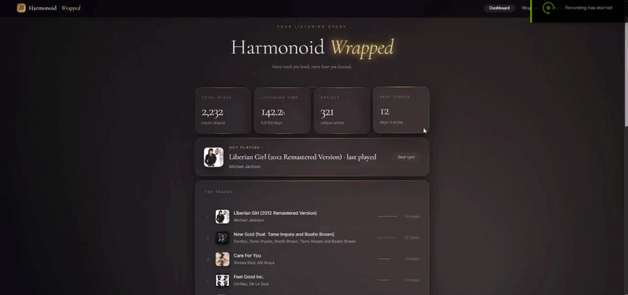

# Harmonoid Wrapped

A Spotify-Wrapped-style listening stats dashboard for [Harmonoid](https://harmonoid.com/), with a live web dashboard, synced lyrics, and a mobile remote control — all running locally on your own machine.

## 🎬 Demo




---

## ✨ Features

- 📊 **Dashboard** — total plays, listening time, top tracks/artists, hourly activity chart
- 🎁 **Wrapped** — a Spotify-Wrapped-style yearly recap of your listening
- 📈 **Charts** — monthly trends, artist breakdown, day-of-week activity
- 🏆 **Achievements** — unlockable milestones based on your listening habits
- 🎵 **Live "Now Playing"** with album art, pulled automatically from iTunes
- 🎼 **Synced lyrics** on mobile, fetched from [LRCLIB](https://lrclib.net/)
- 📱 **Mobile remote** — control playback (play/pause/skip) from your phone over WiFi
- 🌌 **Ambient background** — ambient colors shift to match the current track's album art
- 🔊 **Beat sync** — background visuals pulse in time with your system audio

---

## 🧩 How it works

Harmonoid doesn't expose a public API, so this project taps into the **Windows System Media Transport Controls (SMTC)** — the same system that shows "Now Playing" info in your Windows volume flyout and taskbar.

```
┌─────────────┐      SMTC       ┌─────────────┐      HTTP       ┌──────────────────┐
│  Harmonoid  │ ───────────────▶│ tracker.py  │────────────────▶│    server.py     │
└─────────────┘                 └─────────────┘   (localhost)   └──────────────────┘
                                       │                                  │
                                       ▼                                  ▼
                              harmonoid_stats.db              dashboard.html / mobile.html
                                  (SQLite)                     (served to browser/phone)
```

- **`tracker.py`** polls SMTC every few seconds, logs every play to a local SQLite database, and writes the current "now playing" state to a small JSON file.
- **`server.py`** is a lightweight local HTTP server that reads the database and serves the dashboard, stats API, album art (proxied from iTunes), lyrics (proxied from LRCLIB), and playback controls.
- **`dashboard.html`** is the desktop web dashboard.
- **`mobile.html`** is a mobile-friendly remote control page, reachable from any device on the same WiFi network.

Everything runs **entirely on your own machine** — no cloud services, no accounts, no data leaving your network except the two proxied lookups (album art + lyrics), which are anonymous, read-only requests to public APIs.

---

## 📦 Requirements

- Windows 10 or 11 (SMTC is a Windows-only API)
- [Harmonoid](https://harmonoid.com/) music player
- [Python 3.10+](https://www.python.org/downloads/) installed and added to PATH

---

## 🚀 Setup

### 1. Clone or download this repository

```bash
git clone https://github.com/your-username/harmonoid-wrapped.git
cd harmonoid-wrapped
```

### 2. Install dependencies

```bash
pip install winrt-runtime winrt-Windows.Media.Control winrt-Windows.Foundation winrt-Windows.Foundation.Collections
```

> If `pip` isn't recognized, make sure Python's install folder and its `Scripts` subfolder are both added to your system `PATH`. You can find your Python install path with:
> ```bash
> where python
> ```

### 3. Start the tracker

```bash
python tracker.py
```

Keep this running in the background while you listen to music in Harmonoid. It will print each track as it's detected:

```
[TRACKER] Harmonoid Wrapped is running.
[NOW]  The Weeknd — Blinding Lights (dur:200s)
```

### 4. Start the server

In a **separate terminal**:

```bash
python server.py
```

This prints two URLs:

```
[SERVER] Desktop : http://localhost:8765
[SERVER] Phone   : http://192.168.1.x:8765/mobile
```

### 5. Open the dashboard

Visit **`http://localhost:8765`** in your browser. Don't open `dashboard.html` directly as a file — it needs to be served by `server.py` to fetch live data.

### 6. (Optional) Connect your phone

On a phone connected to the **same WiFi network**, open the "Phone" URL from step 4 in a browser (Chrome recommended). Tap **Add to Home Screen** to install it like an app.

You'll be prompted to enter your PC's local IP address once — it's remembered after that.

---

## ⚙️ Auto-start on login (optional)

To have the tracker and server start silently every time you log in to Windows, use **Task Scheduler**:

1. Press `Win + R` → `taskschd.msc`
2. **Create Basic Task** → name it (e.g. `Harmonoid Wrapped Tracker`)
3. Trigger: **When I log on**
4. Action: **Start a program**
   - Program: `wscript.exe`
   - Arguments: `"C:\full\path\to\start_tracker_silent.vbs"`
   - Start in: the folder this repo is cloned into
5. Repeat for the server with `start_server_silent.vbs`

Both scripts run `pythonw.exe` (no visible console window) and use near-zero CPU/RAM when idle.

---

## 📁 Project structure

```
harmonoid-wrapped/
├── tracker.py               # Background SMTC tracker → SQLite
├── server.py                # Local HTTP server (stats API, artwork, lyrics, controls)
├── dashboard.html            # Desktop dashboard (served at /)
├── mobile.html                # Mobile remote + lyrics (served at /mobile)
├── seed_demo.py              # Populates the DB with demo data to preview the dashboard
├── reset_stats.py           # Wipes all listening history (with confirmation prompt)
├── requirements.txt          # Python dependencies
├── start_tracker_silent.vbs  # Silent launcher for the tracker
├── start_server_silent.vbs   # Silent launcher for the server
└── harmonoid_stats.db        # SQLite database (created on first run)
```

---

## 🔄 Resetting your stats

To wipe your listening history and start fresh:

```bash
python reset_stats.py
```

This asks for confirmation before deleting anything. Your database file and folder structure stay intact — only the play history is cleared.

## 🎨 Previewing without real data

To see the dashboard fully populated before you've built up real listening history:

```bash
python seed_demo.py
```

This generates a year of realistic demo plays. Run `reset_stats.py` afterward to clear it out.

---

## ⚠️ Known limitations

- **Harmonoid only** — the tracker exclusively watches for a Harmonoid session in SMTC. Media playing from other apps (Spotify, YouTube, browsers) is ignored.
- **No seek control** — Harmonoid doesn't implement SMTC's remote-seek handler, so the mobile seek bar is display-only.
- **Lyrics coverage** — synced lyrics depend on [LRCLIB](https://lrclib.net/)'s database; obscure, local, or non-English tracks may not have a match.
- **Local network only** — the mobile remote requires both devices to be on the same WiFi network. It is not accessible from outside your home network, by design.

---

## 🔒 Privacy

Everything runs locally. The only outbound network requests are:
- Album art lookups → [iTunes Search API](https://developer.apple.com/library/archive/documentation/AudioVideo/Conceptual/iTuneSearchAPI/) (public, anonymous, no key required)
- Lyrics lookups → [LRCLIB](https://lrclib.net/) (public, anonymous, no key required)

No listening data, account information, or personal data is ever sent anywhere else.

---

## 📄 License

MIT — do whatever you'd like with this.
